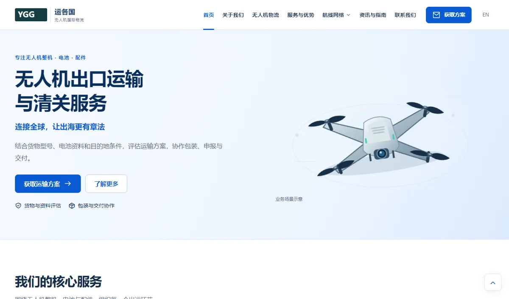
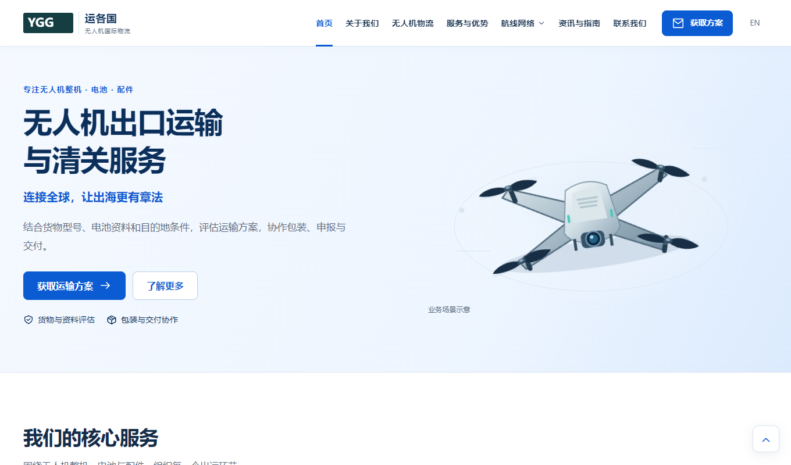
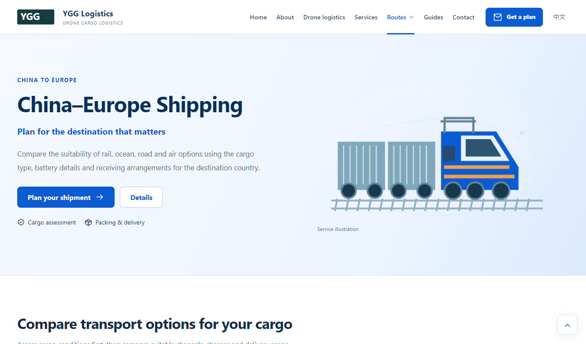

# 运各国国际物流网站

运各国的中英文静态网站。访客先选运输线路或无人机出口场景，再看包装、电池和发运清单，最后打开与该线路对应的询盘表单。

## 实际界面巡览



上图由两张本次实际运行画面的截屏轮换组成，不是连续操作录像。

| 中文版首页 | 英文中欧线路 |
| --- | --- |
|  |  |

## 可以做什么

- 30 个中英文页面，语言切换保留当前主题
- 美国、欧洲、韩国线路与出口服务页
- 浏览器内的询盘演示；不用账号，不对外发信

## 本地运行

```sh
node build.cjs
python -m http.server 8000 --bind 127.0.0.1
```

在浏览器打开 `http://127.0.0.1:8000/`。只监听本机；不执行部署。

## 实测与范围

实测首页的询盘弹窗和英文中欧线路页；没有提交真实询盘。

取自双语静态站源码，不是生产 CMS、会员系统或线上订单备份。联系信息使用保留域名，商标、原版摄影和真实客户资料不随代码授权。

[手机宽度实机截屏（390 px）](showcase/03-mobile.png) · [授权范围](LICENSE) · [来源与署名](NOTICE.md)
